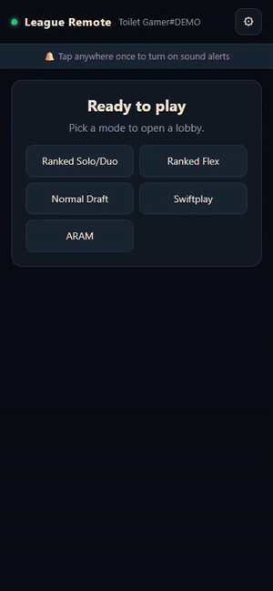
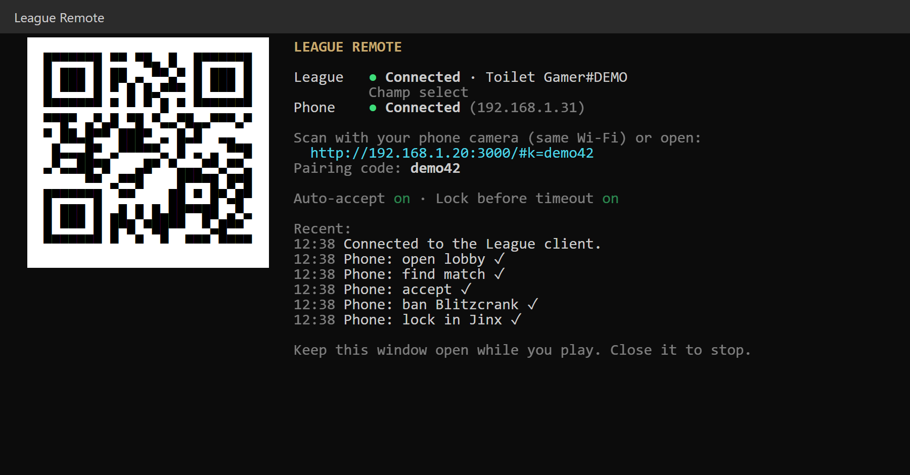
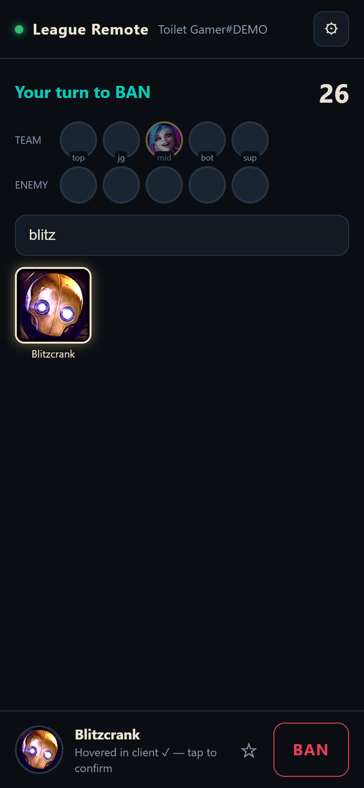
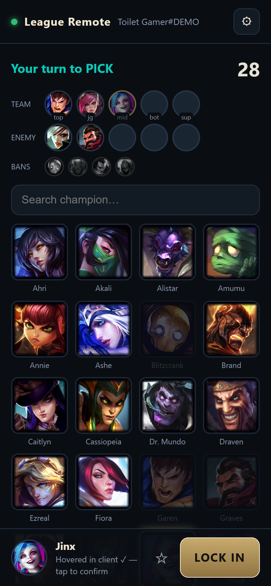

# League Remote

**Accept your League of Legends queue, ban, pick and lock in your champion from your phone.** Queue up, go to the bathroom (or make food), and handle champ select from wherever you are in the house.

<p align="center">
  
</p>

<p align="center"><a href="docs/demo.mp4">▶ Watch the full-quality video</a> · <em>recorded in demo mode against a fake League client</em></p>

## Download

1. Download **[LeagueRemote.exe](https://github.com/aimen08/league-remote/releases/latest/download/LeagueRemote.exe)** from the [latest release](https://github.com/aimen08/league-remote/releases/latest) (Windows, nothing else to install).
2. Double-click it. A window opens with a QR code and the connection status:

   

3. Scan the QR code with your phone camera. **Your phone must be on the same Wi-Fi as your PC.**
4. On your phone, tap **Add to Home Screen** (iPhone: Share → Add to Home Screen, Android: ⋮ → Add to Home screen) so it opens like an app.

> **First run on Windows:**
> - **"Windows protected your PC"**: the exe isn't code-signed. Click **More info → Run anyway**.
> - **Firewall prompt**: tick **Private networks** and click **Allow**, or your phone can't connect.

Keep the window open while you play. It shows a green dot when League is connected and another when your phone is connected.

## What you can do from your phone

| | |
|---|---|
|  | **Lobby**: pick a mode (Ranked Solo/Duo, Flex, Normal Draft, Swiftplay, ARAM), set your **main and second role**, then **Find match**. |
|  | **Match found**: the phone vibrates and beeps (Android), then you tap **Accept**. Or turn on **auto-accept** and the PC accepts by itself. |
|  | **Ban**: search, tap a champion, then **Ban**. You see your team, the enemy team and the bans live. |
|  | **Pick**: tap a champion to hover it, then **Lock in**. Banned, taken and unowned champions are greyed out. Star your mains so they show first. |

## Built to be trusted

A remote you can't trust is worse than no remote. If it says you're locked in and you aren't, you dodge. So the app never shows anything the League client hasn't confirmed:

- **Hover**: "Hovered in client ✓" only appears after the client reports the hover. If the client refuses, the phone goes back to what the client really has and tells you why.
- **Lock in / Ban**: "Locked in ✓" only appears after the PC has re-read the client and seen the lock completed. If the first method doesn't work it tries two others, and if all fail you get a clear **NOT locked** message.
- **Timer**: worked out from the client's own deadline and rounded down, so the phone never shows more time than you really have.
- **Connection lost**: if the phone loses the PC for more than 2.5 seconds, a red banner says the screen may be out of date and the screen dims. A frozen screen never looks current.
- **Turns**: every tap names the exact turn it was meant for. If your turn changed in the meantime (for example the ban ended), the tap is refused instead of landing on the wrong turn.
- **Lock before timeout** (on by default): if you hovered a champion but didn't lock it, the PC locks it with 4 seconds left, so you don't dodge. In testing it locked with about 3 seconds still on the clock.
- **Dodges**: if champ select ends because a player dodged, or a match isn't accepted by everyone, the phone tells you, beeps and shows where you are now.

### Things to know

- **A phone web page can't alert you while it's in the background or the screen is off.** Keep it open, or turn on **auto-accept** (⚙). Auto-accept runs on the PC, so it works even if your phone is locked.
- **Sound alerts** need one tap on the page first (a browser rule). Vibration works on Android only; iPhones don't allow it from web pages.
- **Runes, skins and summoner spells** still have to be set on the PC, and so do **Swiftplay's** pre-picked champions.
- If anything fails in a real game, the details are saved to `%APPDATA%\LeagueRemote\debug-last-error.json`. Please attach that file when you [open an issue](https://github.com/aimen08/league-remote/issues).

## How it works

```
 Phone (browser) ──Wi-Fi──▶ LeagueRemote.exe on your PC ──localhost──▶ League client (LCU API)
```

The League client exposes a local API on your PC (the same one the client's own interface uses). League Remote finds the client's port and password from its process or `lockfile`. It reads the lobby, queue and champ select state twice a second during champ select, and serves the phone app over your local network. Your phone connects with a 6-character pairing code. Nothing leaves your network.

Only the client's lobby and champ select features are used, the same kind of thing Porofessor, Blitz or U.GG do. Nothing touches the game itself. Riot doesn't officially support the client API, so use it at your own risk.

## Run from source / build the exe

Needs [Node.js](https://nodejs.org) 22+.

```bash
npm install
npm start          # run the server
npm run demo       # try the phone app against a fake League client (no League needed)
npm run build      # build dist/LeagueRemote.exe (Node single-executable application)
```

| Setting | Default |
|---|---|
| `PORT` | `3000` |
| `LEAGUE_DIR` | `C:\Riot Games\League of Legends` (only used if the client runs as admin) |

## License

[MIT](LICENSE)
