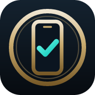
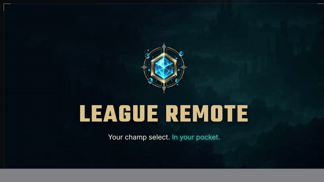
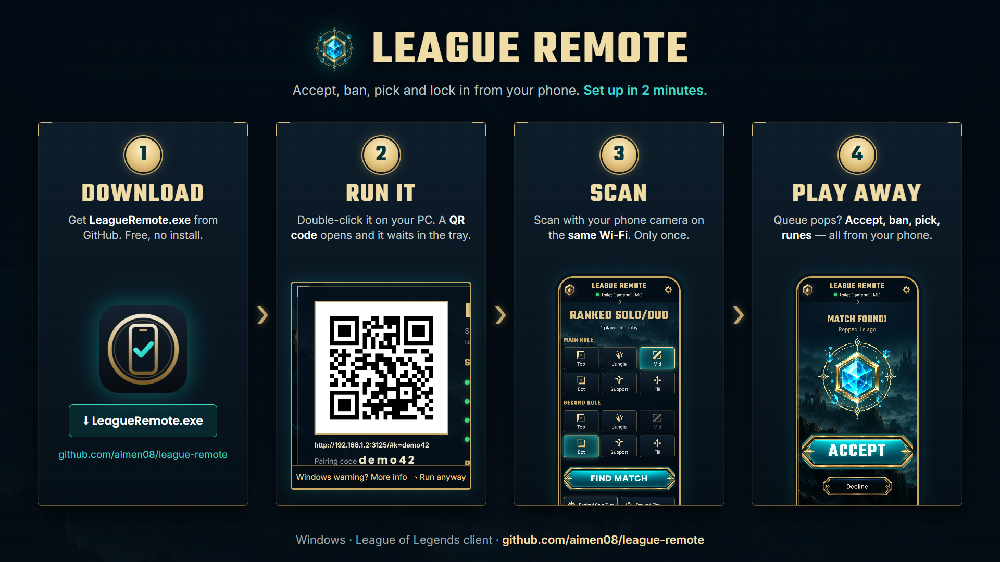
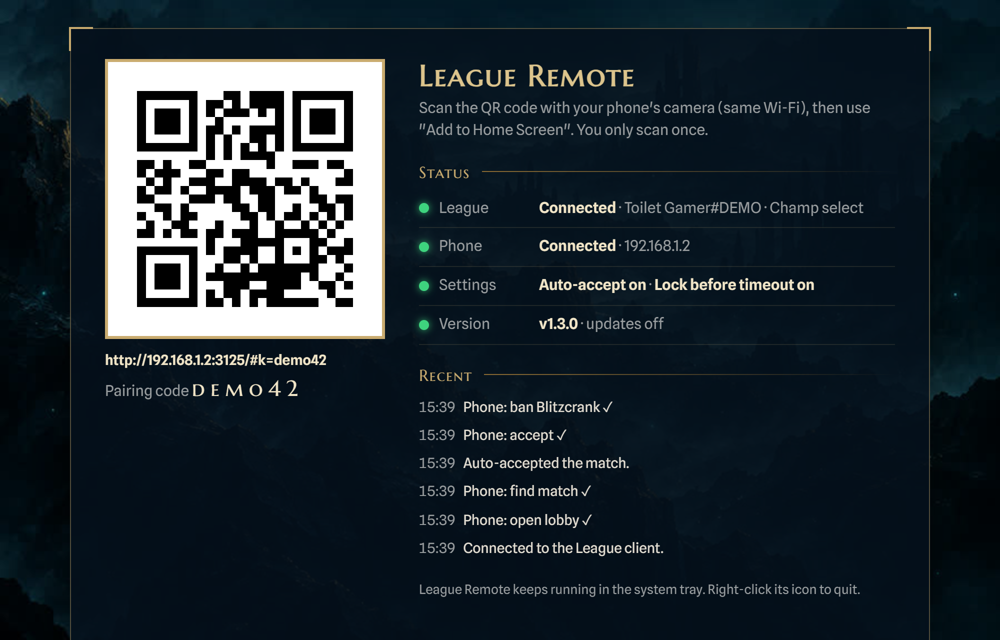
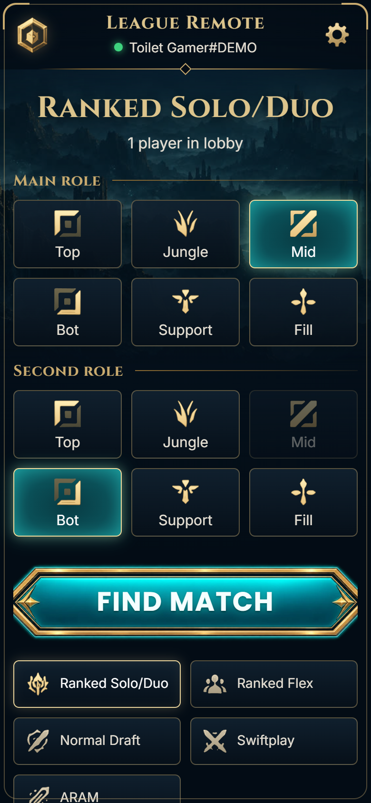
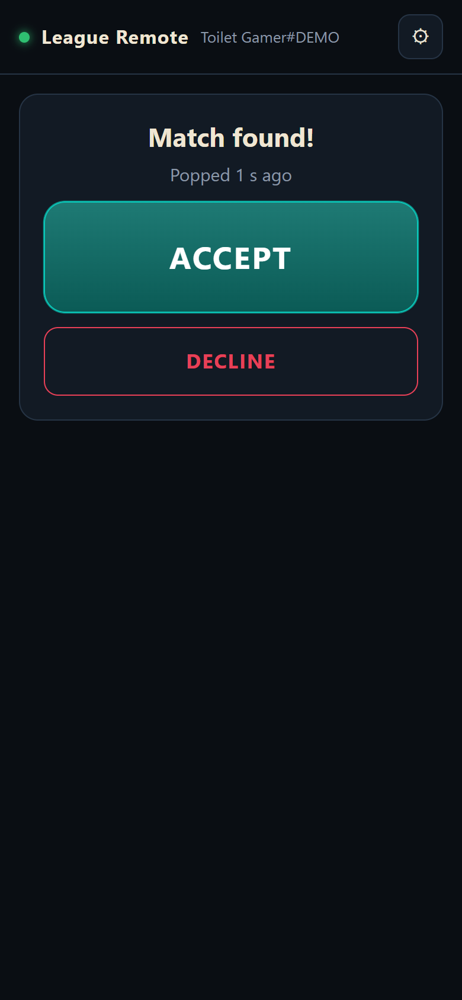
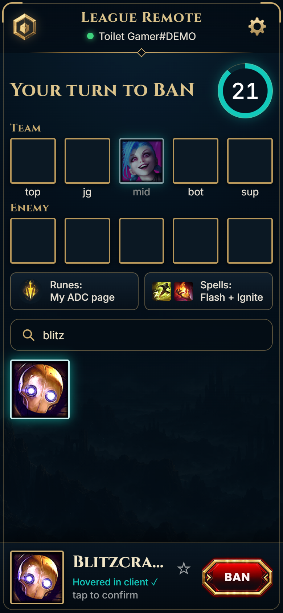
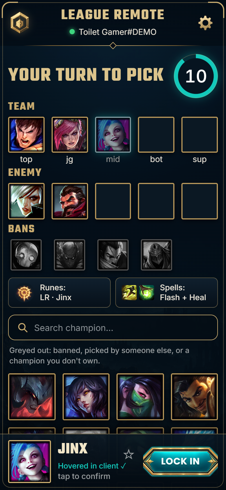
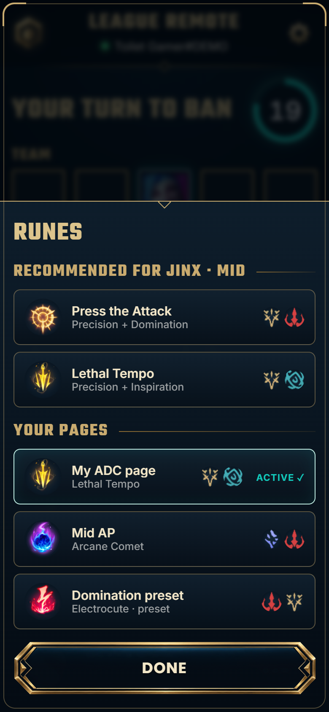
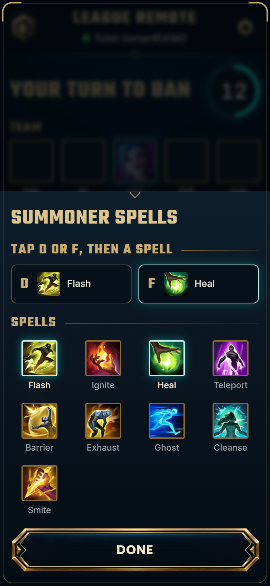

# League Remote

**Accept your League of Legends queue, ban, pick, set runes and summoner spells, and lock in your champion from your phone.** Queue up, go to the bathroom (or make food), and handle champ select from wherever you are in the house.

<p align="center">
  
</p>

<p align="center"><a href="docs/promo-15s.mp4">▶ Watch the 15-second promo (with music)</a> · <a href="docs/promo.mp4">full walkthrough (1080p)</a> · <em>recorded in demo mode against a fake League client</em></p>

## Download

<p align="center"></p>

1. Download **[LeagueRemote.exe](https://github.com/aimen08/league-remote/releases/latest/download/LeagueRemote.exe)** from the [latest release](https://github.com/aimen08/league-remote/releases/latest) (Windows, nothing else to install).
2. Double-click it. It starts in the **system tray** (next to the clock). The first time, it also opens a page on your PC with the QR code and live status:

   

3. Scan the QR code with your phone camera. **Your phone must be on the same Wi-Fi as your PC.**
4. On your phone, tap **Add to Home Screen** (iPhone: Share → Add to Home Screen, Android: ⋮ → Add to Home screen) so it opens like an app.

> **First run on Windows:**
> - **"Windows protected your PC"**: the exe isn't code-signed. Click **More info → Run anyway**.
> - **Firewall prompt**: tick **Private networks** and click **Allow**, or your phone can't connect.

**The tray icon** shows whether League and your phone are connected (hover over it). Double-click it, or right-click → **Show QR code and status**, to see the page above again. Right-click → **Quit League Remote** to stop it.

**You only scan once.** Your pairing is saved on the PC, and the phone reconnects by itself whenever League Remote restarts or updates. Opening League Remote again closes the old copy and takes its place. If a different program already uses port 3000, League Remote leaves that program alone, moves to the next free port, and shows a new QR code to scan.

### Automatic updates

League Remote checks GitHub for a new version when it starts and every 6 hours after that. When there is one, it:

1. downloads it in the background and checks its **SHA-256 checksum** against GitHub's (a damaged or tampered download is deleted, never installed),
2. **waits until you're not in queue, at match found, or in champ select**, because restarting must never cost you a queue pop or a pick,
3. swaps the exe and restarts straight back into the tray. Your phone reconnects and reloads by itself, and no rescan is needed.

If anything goes wrong, it keeps running the version you have and tries again later. To turn updates off, set the `LEAGUE_REMOTE_NO_UPDATE=1` environment variable. *(Coming from v1.0 or v1.1? Download the latest version once by hand. Updates are automatic from v1.2 on.)*

## What you can do from your phone

| | |
|---|---|
|  | **Lobby**: pick a mode (Ranked Solo/Duo, Flex, Normal Draft, Swiftplay, ARAM), set your **main and second role**, then **Find match**. |
|  | **Match found**: the phone vibrates and beeps (Android), then you tap **Accept**. Or turn on **auto-accept** and the PC accepts by itself. |
|  | **Ban**: search, tap a champion, then **Ban**. Your team, the enemy team and the bans update live. Every current champion is there, because the list comes from your client. |
|  | **Pick**: tap a champion to hover it, then **Lock in**. Banned, taken and unowned champions are greyed out. Star your mains so they show first. |
|  | **Runes**: Riot's **recommended runes** for your champion and role in one tap, or switch to any of your own pages. |
|  | **Summoner spells**: tap D or F, then a spell. Only spells allowed in the current mode are shown; picking the spell from the other slot swaps them. |

## Built to be trusted

A remote you can't trust is worse than no remote. If it says you're locked in and you aren't, you dodge. So the app never shows anything the League client hasn't confirmed:

- **Hover**: "Hovered in client ✓" only appears after the client reports the hover. If the client refuses, the phone goes back to what the client really has and tells you why.
- **Lock in / Ban**: "Locked in ✓" only appears after the PC has re-read the client and seen the lock completed. If the first method doesn't work it tries two others, and if all fail you get a clear **NOT locked** message.
- **Runes and spells**: only shown as set once the client reports them. Recommended runes go to a page named **"LR · <champion>"**, which is reused next time. If all your page slots are full, the phone **asks before replacing one of your pages** and never replaces one silently.
- **Timer**: worked out from the client's own deadline and rounded down, so the phone never shows more time than you really have.
- **Connection lost**: if the phone loses the PC for more than 2.5 seconds, a red banner says the screen may be out of date and the screen dims. A frozen screen never looks current.
- **Turns**: every tap names the exact turn it was meant for. If your turn changed in the meantime (for example the ban ended), the tap is refused instead of landing on the wrong turn.
- **Lock before timeout** (off by default, switch it on in ⚙ settings): if you hovered a champion or ban but didn't lock it, the PC locks it with 4 seconds left, so you don't dodge. In testing it locked with about 3 seconds still on the clock.
- **Dodges**: if champ select ends because a player dodged, or a match isn't accepted by everyone, the phone tells you, beeps and shows where you are now.

### Things to know

- **A phone web page can't alert you while it's in the background or the screen is off.** Keep it open, or turn on **auto-accept** (⚙). Auto-accept runs on the PC, so it works even if your phone is locked.
- **Sound alerts** need one tap on the page first (a browser rule). Vibration works on Android only; iPhones don't allow it from web pages.
- **Skins** still have to be chosen on the PC, and so do **Swiftplay's** pre-picked champions.
- If anything fails in a real game, the details are saved to `%APPDATA%\LeagueRemote\debug-last-error.json`. Please attach that file when you [open an issue](https://github.com/aimen08/league-remote/issues).

## How it works

```
 Phone (browser) ──Wi-Fi──▶ LeagueRemote.exe on your PC ──localhost──▶ League client (LCU API)
```

The League client exposes a local API on your PC (the same one the client's own interface uses). League Remote finds the client's port and password from its process or `lockfile`. It reads the lobby, queue and champ select state twice a second during champ select, and serves the phone app over your local network. Your phone connects with a 6-character pairing code. Nothing leaves your network.

Only the client's lobby and champ select features are used, the same kind of thing Porofessor, Blitz or U.GG do. Nothing touches the game itself. Riot doesn't officially support the client API, so use it at your own risk.

## Run from source / build the exe

Needs [Node.js](https://nodejs.org) 22+.

```bash
npm install
npm start          # run the server in this console window (no tray)
npm run demo       # try the phone app against a fake League client with today's full roster (no League needed)
npm run build      # build dist/LeagueRemote.exe (Node single-executable application)
npm run icons      # re-render the icons from assets/icon.svg (outputs are committed)
```

`LeagueRemote.exe --foreground` runs the exe in its console window instead of the tray, which is useful for seeing errors.

| Setting | Default |
|---|---|
| `PORT` | `3000` (the next free port is used if another program has it) |
| `LEAGUE_DIR` | `C:\Riot Games\League of Legends` (only used if the client runs as admin) |
| `LEAGUE_REMOTE_DATA` | `%APPDATA%\LeagueRemote`: pairing code, settings, debug log (shared by the exe and `npm start`) |
| `LEAGUE_REMOTE_NO_UPDATE` | unset (set to `1` to turn off update checks) |

## Credits

Fonts: [Cinzel](https://fonts.google.com/specimen/Cinzel) for titles, [Poppins](https://fonts.google.com/specimen/Poppins) for buttons and [Inter](https://fonts.google.com/specimen/Inter) for text (SIL Open Font License, licenses in `public/fonts`). The background landscape, hextech crystal and button art were generated for this project; the role, queue, logo and settings icons were traced to SVG from the approved design (sources in `assets/icons`). Champion, rune and spell images come from your own League client; demo mode uses [Community Dragon](https://communitydragon.org).

## License

[MIT](LICENSE)
